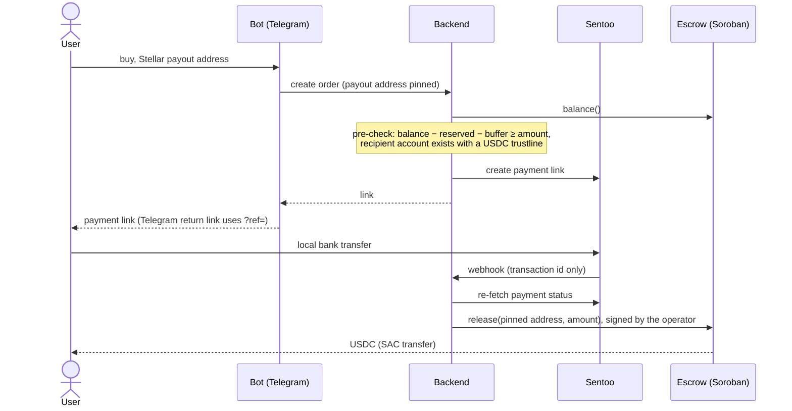

# Architecture

Stellar/Soroban rebuild of the EVM fiat↔USDC ramp. Same product and off-chain
flow; the chain layer is Stellar.

## Flow (on-ramp)
1. Bot (Telegram) takes the order and the user's Stellar payout address.
2. Backend creates a Sentoo payment link (local bank transfer).
3. User pays → Sentoo webhook → backend re-fetches authoritative status.
4. Backend calls the Soroban escrow `release` (signed by the operator) → USDC to
   the user's address.

Off-ramp is the reverse (user sends USDC to the escrow, receives a bank payout).

The diagram shows the on-ramp, including the two checks that keep a buyer from
paying for USDC that can't be delivered: the pre-check runs before the payment
link exists, and the release goes only to the address pinned at order-create.

## Components
- **Soroban escrow** (`contracts/escrow`): mirrors the EVM `Escrow.sol`. A shared
  USDC pool with off-chain order accounting (no per-order balances on-chain):
  anyone may `deposit`; only the owner (backend operator) can `release` to a buyer
  or `withdraw` to itself. Tokens move through the SAC `token` interface, so any
  Soroban token works; amounts are `i128` in the token's smallest unit.
- **Backend**: webhooks, order state machine, release signer.
- **Bot**: chat UX, quotes, order creation. No keys.
- **Supabase**: users/orders/audit.

## Ported invariants (from the EVM ramp)
- Sentoo webhook is untrusted; re-fetch status before acting.
- Compare-and-set order transitions + append-only audit.
- Release to the payout address pinned at order-create.
- Liquidity pre-check before taking payment (fail closed).
- `?ref=` Telegram return link (survives Sentoo's appended `/status`).

## Stellar-specific
- USDC via its **SAC**; **7 decimals**; recipients need a **trustline** and a
  created account.
- Operator account signs `release`/`withdraw` (`require_auth`). Mainnet custody =
  KMS/MPC/multisig, not a raw key.
- Networks: Testnet → (Futurenet) → Mainnet, bounded canary first.
